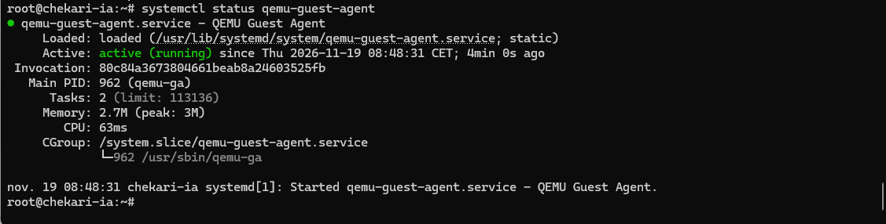
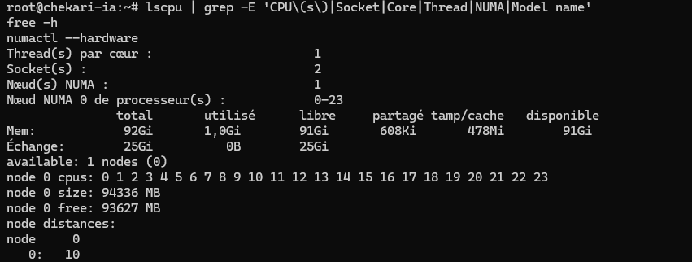
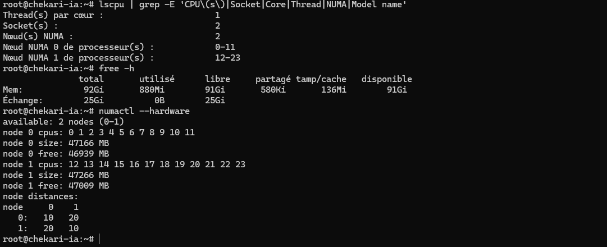
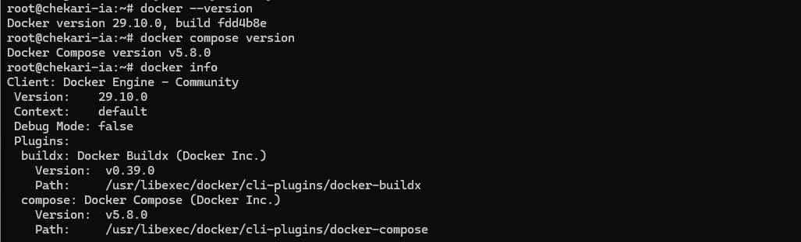
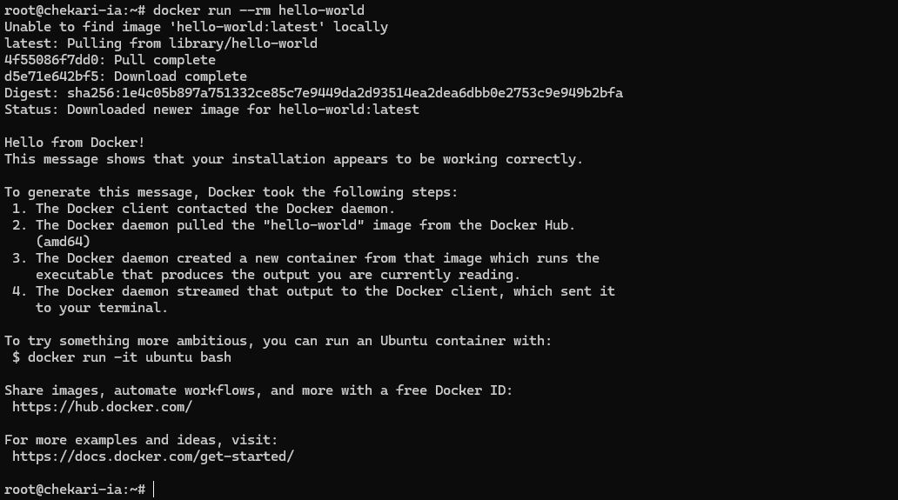
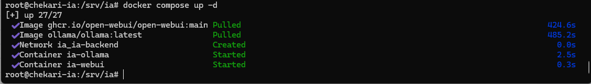
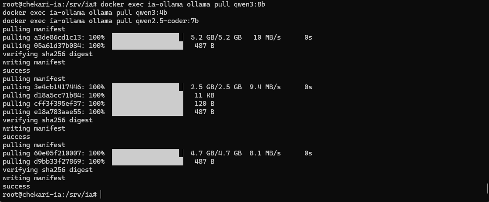

L'objectif est d'installer et de configurer un **LLM** (Large Language Model) sur votre machine locale. Cela vous permettra d'utiliser un modèle de langage avancé pour diverses applications, telles que la génération de texte, la traduction, et plus encore.

Je vais utiliser un serveur Proxmox pour héberger le LLM, mais vous pouvez également l'installer sur votre machine locale si vous le souhaitez.
- **CPU** : 24 coeurs.
- **RAM** : 96 Go.
- **Stockage** : 500 Go.

On commence par faire une installation de Debian 13 sur la machine virtuelle.

Mettre à jour votre système :

```bash
apt update && apt full-upgrade -y
```

Nous allons ensuite installer tous les paquets nécessaires pour faire tourner le LLM. Pour cela, nous allons installer **Docker** et **Docker Compose**...

```bash
apt install -y \
  curl \
  wget \
  git \
  nano \
  htop \
  jq \
  ca-certificates \
  gnupg \
  numactl \
  qemu-guest-agent
```

On va vérifier que le Qemu Guest Agent est bien installé et activé. Pour cela, on va vérifier le statut du service :

```bash
systemctl status qemu-guest-agent
```



Avant l'installation d'Ollama, vérifions ce que Debian voit réellement.

```bash
lscpu | grep -E 'CPU\(s\)|Socket|Core|Thread|NUMA|Model name'
free -h
numactl --hardware
```



Le nombre de coeurs et de threads est correct, mais le nombre de NUMA est à 0. Il faut donc activer le NUMA dans Proxmox pour que le LLM fonctionne correctement.

```
qm shutdown VMID
qm set VMID --numa 1
qm start VMID
```

On voit bien les deux CPU et les deux NUMA. On peut maintenant installer Ollama.



## Installation de docker

Installation depuis le dépôt officiel Docker.

```bash
install -m 0755 -d /etc/apt/keyrings
curl -fsSL https://download.docker.com/linux/debian/gpg   -o /etc/apt/keyrings/docker.asc
chmod a+r /etc/apt/keyrings/docker.asc
```

Ajout du dépôt Docker à APT :

```bash
cat > /etc/apt/sources.list.d/docker.sources <<EOF
Types: deb
URIs: https://download.docker.com/linux/debian
Suites: trixie
Components: stable
Signed-By: /etc/apt/keyrings/docker.asc
EOF
```

Installer Docker et Compose

```bash
apt update

apt install -y \
  docker-ce \
  docker-ce-cli \
  containerd.io \
  docker-buildx-plugin \
  docker-compose-plugin
```

On active le service Docker pour qu'il démarre automatiquement au démarrage du système.

```bash
systemctl enable --now docker
```

On va verifier que Docker est bien installé et fonctionne correctement.

```bash
docker --version
docker compose version
docker info
```



On peut maintenant lancer le conteneur HelloWorld pour vérifier que Docker fonctionne correctement.

```bash
docker run hello-world
```



## Installation d'Ollama

Nous allons créer un dossier pour Ollama et y télécharger le script d'installation.

```bash
mkdir -p /srv/ia
cd /srv/ia
```

Ensuite, on va créer un fichier Docker compose.

```bash
nano compose.yaml
```

Avec cette configuration :

```yaml
services:

  ollama:
    image: ollama/ollama:latest
    container_name: ia-ollama
    restart: unless-stopped

    volumes:
      - ./ollama:/root/.ollama

    environment:
      OLLAMA_NUM_PARALLEL: "1"
      OLLAMA_MAX_LOADED_MODELS: "1"
      OLLAMA_KEEP_ALIVE: "10m"

    mem_limit: 80g

    networks:
      - ia-backend

  open-webui:
    image: ghcr.io/open-webui/open-webui:main
    container_name: ia-webui
    restart: unless-stopped

    ports:
      - "3000:8080"

    environment:
      OLLAMA_BASE_URL: "http://ollama:11434"
      WEBUI_AUTH: "True"
      DEFAULT_MODELS: "qwen3:8b"

    volumes:
      - ./open-webui:/app/backend/data

    depends_on:
      - ollama

    networks:
      - ia-backend

networks:
  ia-backend:
    driver: bridge
```

On peut maintenant démarrer les conteneurs avec la commande suivante :

```bash
docker compose up -d
```



On va maintenant vérifier que les conteneurs sont bien démarrés et fonctionnent correctement.

```bash
docker ps
```

## Installation des modèles

Pour tester plusieurs modèles, nous allons installer les modèles suivants :
- **qwen3:8b** : Modèle de langage avancé.
- **qwen3:4b** : Modèle de langage plus léger.
- **qwen2.5-coder:7b** : Modèle de langage spécialisé pour la programmation.

```bash
docker exec ia-ollama ollama pull qwen3:8b
docker exec ia-ollama ollama pull qwen3:4b
docker exec ia-ollama ollama pull qwen2.5-coder:7b
```



Pour voir la liste des modèles installés, on peut utiliser la commande suivante :

```bash
docker exec ia-ollama ollama list
```

Pour tester le modèle qwen3:8b, on peut utiliser la commande suivante :

```bash
docker exec -it ia-ollama ollama run qwen3:8b
```

Pour quitter le modèle, il suffit de taper `/bye`.

Pour tester depuis le navigateur, on peut se rendre à l'adresse suivante : `http://IP_DE_VOTRE_SERVEUR:3000`. Vous pourrez alors interagir avec le modèle directement depuis l'interface web.