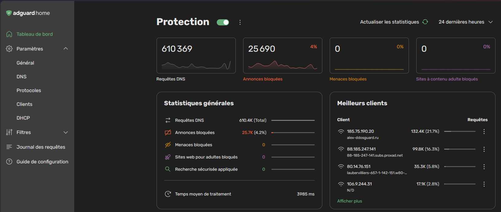

---
title: "AdGuard Home 1.0 : huit ans de développement et une nouvelle ère"
description: "Découvrez les nouveautés d'AdGuard Home 1.0 : interface modernisée, performances améliorées, gestion des clients et remplacement de Quad9 par Cloudflare."
date: 2026-11-27
tags:
  - AdGuard Home
  - DNS
  - Sécurité
  - Open Source
  - Self-Hosting
---

Après huit années de développement, **AdGuard Home franchit enfin le cap de la version 1.0**. Disponible depuis le 19 novembre 2026, cette version majeure marque un tournant pour cette solution open source de filtrage DNS.

Au programme : une interface entièrement repensée, une consommation de ressources réduite, une administration simplifiée et un nouveau cycle de développement.

## Qu'est-ce qu'AdGuard Home ?

AdGuard Home est une solution gratuite et open source permettant de filtrer les requêtes DNS à l'échelle d'un réseau.

Contrairement aux extensions installées dans les navigateurs, AdGuard Home intervient directement au niveau de la résolution DNS. Il protège ainsi les équipements qui utilisent son service DNS, sans nécessiter l'installation d'un logiciel sur chaque appareil.

Ses principales fonctionnalités sont :

- Blocage des domaines publicitaires et des traqueurs.
- Filtrage des domaines malveillants.
- Contrôle parental.
- Gestion des clients et des règles personnalisées.
- Statistiques et journalisation des requêtes DNS.
- Réécriture des enregistrements DNS.
- Serveur DHCP intégré.
- Prise en charge du DNS-over-HTTPS (DoH), DNS-over-TLS (DoT) et DNS-over-QUIC (DoQ).

AdGuard Home peut notamment être installé sur un serveur Linux, un Raspberry Pi, une machine virtuelle Proxmox ou dans un conteneur Docker sur un NAS.



## Les principales nouveautés de la version 1.0

### Une interface entièrement modernisée

La nouveauté la plus visible est la refonte complète de l'interface d'administration.

Le nouveau frontend apporte :

- Un design plus moderne.
- Une navigation adaptée aux smartphones et tablettes.
- Une meilleure réactivité.
- Un tableau de bord plus lisible.
- Une consommation de mémoire optimisée.

L'organisation générale reste cependant familière afin de faciliter la transition des utilisateurs existants.

### Un tableau de bord plus lisible

Le tableau de bord permet de retrouver rapidement les principaux indicateurs de fonctionnement du serveur DNS :

- Nombre de requêtes DNS.
- Nombre de requêtes bloquées.
- Temps moyen de traitement.
- Domaines les plus sollicités.
- Domaines les plus bloqués.
- Clients les plus actifs.

Ces informations sont particulièrement utiles pour identifier un comportement anormal ou diagnostiquer un problème de résolution DNS.

### Une gestion des clients plus précise

L'administration des équipements bénéficie de paramètres plus granulaires.

Il devient notamment plus simple de distinguer les paramètres de protection globaux des réglages propres à chaque équipement.

Cette évolution permet, par exemple, de définir des politiques différentes pour :

- Les ordinateurs personnels.
- Les smartphones.
- Les télévisions connectées.
- Les équipements domotiques.
- Les appareils des enfants.

Les serveurs DNS en amont et les paramètres du cache peuvent également être personnalisés par client.

### Un journal DNS amélioré

Le journal des requêtes bénéficie d'une présentation enrichie et de nouvelles possibilités de tri et de filtrage.

Il constitue un outil essentiel pour comprendre pourquoi un domaine est bloqué, identifier les requêtes d'un équipement ou rechercher l'origine d'un dysfonctionnement réseau.

### Une meilleure gestion des filtres

L'administration des listes de filtrage a également été revue.

On retrouve notamment :

- Les listes de blocage DNS.
- Les listes d'autorisation.
- Les règles de filtrage personnalisées.
- Les réécritures DNS.
- Les paramètres de mise à jour des listes.

L'objectif est de faciliter l'administration quotidienne du filtrage.

## Des performances et une stabilité améliorées

Au-delà de l'aspect graphique, la réécriture du frontend vise à limiter la consommation de ressources côté interface.

Cette optimisation est particulièrement intéressante pour les installations utilisant du matériel aux ressources limitées, comme les Raspberry Pi ou certains routeurs.

La version stable apporte également différents correctifs concernant le DHCP, la validation des adresses réseau, le traitement des requêtes DNS et les mécanismes de mise à jour.

## Attention : Cloudflare remplace Quad9

Cette version introduit un changement particulièrement important pour les utilisateurs français.

**Cloudflare remplace Quad9 comme fournisseur DNS par défaut pour les nouvelles installations d'AdGuard Home.**

Ce changement intervient dans le contexte de l'arrêt de la fourniture du service DNS de Quad9 en France, annoncé pour le 24 novembre 2026.

### Ancienne configuration DNS

Le serveur DNS en amont utilisé précédemment était :

```text
https://dns10.quad9.net/dns-query
```

Les serveurs DNS bootstrap étaient :

```text
9.9.9.10
149.112.112.10
2620:fe::10
2620:fe::fe:10
```

### Nouvelle configuration DNS

Le nouveau serveur DNS en amont est :

```text
https://cloudflare-dns.com/dns-query
```

Les nouveaux serveurs DNS bootstrap sont :

```text
1.1.1.1
1.0.0.1
2606:4700:4700::1111
2606:4700:4700::1001
```

> **Attention :** les installations existantes ne sont pas automatiquement modifiées lors de la mise à jour vers AdGuard Home 1.0.

Si vous utilisez encore Quad9 depuis la France et rencontrez des problèmes de résolution DNS, il est recommandé de vérifier votre configuration.

Depuis l'interface d'administration, rendez-vous dans :

**Paramètres > Paramètres DNS**

Vérifiez les éléments suivants :

1. Serveurs DNS en amont (Upstream DNS servers).
2. Serveurs DNS bootstrap.
3. Serveurs DNS de secours (Fallback DNS servers).

Il n'est pas obligatoire d'utiliser Cloudflare. D'autres fournisseurs DNS restent disponibles.

### Vérifier le fonctionnement du DNS

Depuis un serveur Linux, il est possible de tester directement la disponibilité d'un résolveur DNS avec la commande `dig` :

```bash
dig @9.9.9.10 cloudflare-dns.com +time=3 +tries=1
```

Puis de comparer le résultat avec Cloudflare :

```bash
dig @1.1.1.1 cloudflare-dns.com +time=3 +tries=1
```

Pour vérifier ensuite le fonctionnement d'AdGuard Home, remplacez l'adresse suivante par celle de votre serveur :

```bash
dig @192.168.1.10 example.org
```

Un délai d'attente dépassé peut indiquer un problème d'accessibilité du résolveur DNS, de routage ou de filtrage réseau.

## Comment mettre à jour AdGuard Home ?

La version 1.0 conserve le même schéma de configuration que les versions 0.107.x.

Il n'est donc pas nécessaire de reconfigurer entièrement son serveur.

### Sauvegarde préalable

Avant toute mise à jour, il est recommandé de sauvegarder :

- Le fichier `AdGuardHome.yaml`.
- Le répertoire `data`.
- Le binaire AdGuard Home ou la version de l'image Docker utilisée.

Pour garantir la cohérence de la sauvegarde, il est préférable d'arrêter temporairement le service.

### Mise à jour depuis l'interface Web

La méthode la plus simple consiste à utiliser le mécanisme de mise à jour intégré.

1. Connectez-vous à l'interface d'administration.
2. Vérifiez la disponibilité d'une nouvelle version.
3. Lancez la mise à jour.
4. Attendez le redémarrage du service.
5. Vérifiez le bon fonctionnement de la résolution DNS.

### Mise à jour en ligne de commande

Pour une installation native sous Linux, depuis le répertoire d'installation :

```bash
sudo ./AdGuardHome --update -v
```

Pour vérifier la version installée :

```bash
./AdGuardHome --version
```

Pour une installation utilisant systemd, il est également possible de vérifier l'état du service :

```bash
systemctl status AdGuardHome
```

### Mise à jour avec Docker Compose

Pour une installation Docker Compose utilisant le tag `latest` :

```yaml
image: adguard/adguardhome:latest
```

Téléchargez la nouvelle image :

```bash
docker compose pull
```

Recréez le conteneur :

```bash
docker compose up -d
```

Vérifiez les journaux :

```bash
docker compose logs -f
```

Assurez-vous que les répertoires de configuration et de données sont bien persistants avant de recréer le conteneur.

## Un nouveau cycle de développement

Le passage à la version 1.0 marque également une évolution dans la stratégie de développement du projet.

Les développeurs souhaitent désormais proposer plus régulièrement de nouvelles fonctionnalités, sans se limiter aux correctifs et aux mises à jour de dépendances.

En contrepartie, les futures versions mineures pourront introduire des changements incompatibles avec certaines configurations ou intégrations existantes.

Il sera donc important de consulter les notes de version avant chaque mise à jour.

## Les prochaines fonctionnalités

Plusieurs évolutions sont déjà annoncées pour les futures versions :

- Une page d'autodiagnostic.
- L'importation massive de listes de filtrage.
- Un moteur de recherche intégré à l'interface.
- La génération automatique des certificats TLS.
- Le renouvellement automatique des certificats TLS.

Ces fonctionnalités sont encore en développement et ne sont pas intégrées à la version 1.0.0.

## Faut-il passer à AdGuard Home 1.0 ?

Cette nouvelle version constitue une évolution intéressante pour les utilisateurs actuels d'AdGuard Home.

| Critère | AdGuard Home 0.107.x | AdGuard Home 1.0 |
| --- | --- | --- |
| Interface | Ancienne génération | Refonte complète |
| Navigation mobile | Ancienne interface | Interface responsive |
| Consommation mémoire du frontend | Moins optimisée | Optimisée |
| Gestion des clients | Paramètres existants | Paramètres plus granulaires |
| Journal DNS | Interface historique | Tri et filtrage améliorés |
| DNS par défaut | Quad9 | Cloudflare |
| Configuration existante | Compatible | Conservée |
| Développement | Maintenance et évolutions | Développement actif |

La mise à jour est recommandée après une sauvegarde et une vérification des éventuelles intégrations personnalisées.

## Conclusion

AdGuard Home 1.0 représente bien plus qu'un changement de numéro de version.

La modernisation de l'interface, les optimisations techniques et la reprise d'un développement plus actif donnent un nouveau souffle au projet.

Pour les amateurs de self-hosting, les administrateurs systèmes et réseaux ou les particuliers souhaitant reprendre le contrôle de leurs requêtes DNS, AdGuard Home reste une excellente solution de filtrage réseau.

Une attention particulière devra cependant être portée à la configuration des serveurs DNS pour les installations situées en France.

Après huit années de développement, cette version 1.0 ouvre un nouveau chapitre pour le projet.

## Sources et liens utiles

- [Site officiel AdGuard Home](https://adguard.com/fr/adguard-home/overview.html)
- [Annonce officielle de la version 1.0](https://adguard.com/fr/blog/adguard-home-v-1-0.html)
- [Notes de version 1.0.0](https://github.com/AdguardTeam/AdGuardHome/releases/tag/v1.0.0)
- [Dépôt GitHub](https://github.com/AdguardTeam/AdGuardHome)
- [Documentation officielle](https://github.com/AdguardTeam/AdGuardHome/wiki)
