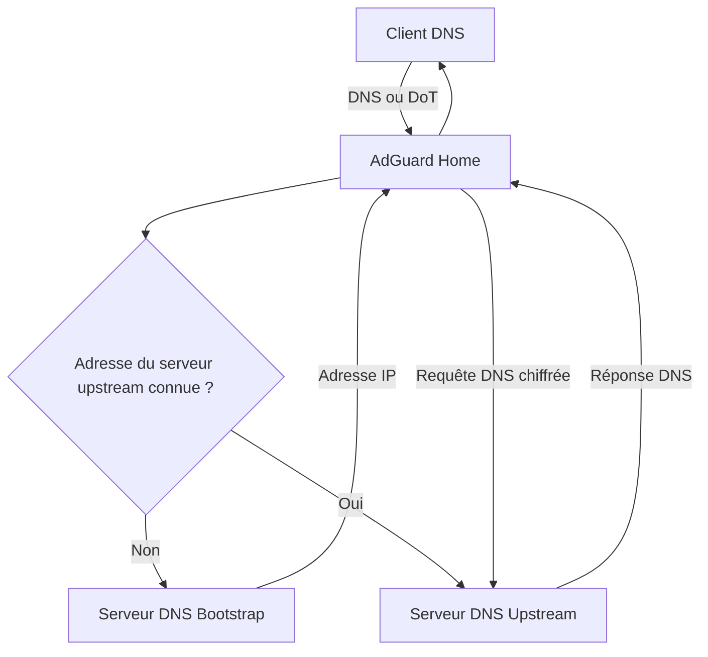

## Contexte

Depuis le 24 novembre 2026, Quad9 a désactivé ses services DNS pour les utilisateurs situés en France, à la suite d'une décision de justice.

Cette situation peut avoir des conséquences sur les infrastructures utilisant AdGuard Home, notamment lorsque Quad9 est configuré comme serveur DNS en amont ou comme serveur DNS bootstrap.

Même si vous utilisez Cloudflare ou Google comme serveurs DNS principaux, votre infrastructure peut être indirectement affectée.

J'ai rencontré ce problème sur mon installation AdGuard Home hébergée sur un VPS Debian 13, avec notamment un profil DNS over TLS installé sur mon iPhone.

## Symptômes rencontrés

Les premiers symptômes étaient assez déroutants :

- Certaines applications fonctionnaient normalement, comme TikTok.
- D'autres applications, comme Clash Royale, ne parvenaient plus à se connecter.
- Certains sites Internet étaient inaccessibles.
- Le DNS over TLS semblait ne plus fonctionner correctement.
- Le certificat Let's Encrypt était toujours valide.
- Le service AdGuard Home était actif.
- Le redémarrage du service ne résolvait pas le problème.

La présence de réponses DNS en cache pouvait expliquer pourquoi certaines applications continuaient temporairement à fonctionner.

## Vérification du certificat TLS

Dans un premier temps, j'ai suspecté un problème lié au certificat Let's Encrypt utilisé par AdGuard Home.

Pour vérifier le certificat présenté par le serveur DNS over TLS, utilisez la commande suivante :

```bash
openssl s_client \
-connect dns.example.com:853 \
-servername dns.example.com \
-verify_hostname dns.example.com \
-showcerts </dev/null
```

Remplacez `dns.example.com` par votre propre nom de domaine.

Le résultat obtenu était le suivant :

```text
Verification: OK
Verified peername: dns.example.com
Verify return code: 0 (ok)
```

Le certificat utilisait la nouvelle génération de certificats Let's Encrypt, avec la chaîne suivante :

```text
ISRG Root X1
    └── Root YR
        └── Let's Encrypt YR1
            └── dns.example.com
```

La chaîne était valide et la négociation TLS fonctionnait correctement avec OpenSSL.

Il n'était donc pas nécessaire de renouveler le certificat ou de modifier manuellement sa chaîne de certification.

## Vérification du service AdGuard Home

### État du service

```bash
systemctl status AdGuardHome
```

Le service était correctement démarré :

```text
Active: active (running)
```

### Vérification des ports

```bash
ss -lntup | grep -E ':(53|853)\b'
```

Résultat :

```text
udp   UNCONN   *:53
tcp   LISTEN   *:53
tcp   LISTEN   *:853
```

Les ports nécessaires étaient bien utilisés par AdGuard Home.

| Port | Protocole | Utilisation |
| --- | --- | --- |
| 53 | UDP | DNS classique |
| 53 | TCP | DNS classique |
| 853 | TCP | DNS over TLS |

### Vérification des ressources

Les ressources du serveur ont également été vérifiées :

```bash
free -h
df -h
```

Ainsi que les éventuels arrêts de processus provoqués par un manque de mémoire :

```bash
journalctl -k --no-pager | grep -Ei 'oom|out of memory|killed process'
```

Aucune saturation actuelle ni trace d'arrêt par l'OOM Killer n'a été constatée dans les journaux consultés.

## Tester la résolution DNS

### DNS classique

Depuis le serveur hébergeant AdGuard Home :

```bash
dig @127.0.0.1 google.com
```

La requête échouait :

```text
communications error to 127.0.0.1#53: timed out
no servers could be reached
```

### DNS over TLS

Pour tester directement le DNS over TLS, installez l'utilitaire `kdig` :

```bash
apt update
apt install knot-dnsutils
```

Effectuez ensuite une requête DNS chiffrée :

```bash
kdig @dns.example.com \
+tls-ca \
+tls-hostname=dns.example.com \
google.com
```

Le résultat était également un échec :

```text
WARNING: TLS, peer took too long to respond
ERROR: failed to query server
```

Même en désactivant la validation du certificat pour les besoins du diagnostic, le problème persistait :

```bash
kdig @127.0.0.1 +tls google.com
```

Ces différents tests ont permis d'orienter le diagnostic vers le fonctionnement de la résolution DNS plutôt que vers le certificat TLS.

## Comprendre le rôle des serveurs DNS bootstrap

AdGuard Home peut utiliser des serveurs DNS en amont accessibles via différents protocoles :

- DNS classique (UDP ou TCP).
- DNS over TLS (DoT).
- DNS over HTTPS (DoH).
- DNS over QUIC (DoQ).

Dans mon installation, les serveurs DNS en amont étaient configurés en DNS over HTTPS :

```text
https://cloudflare-dns.com/dns-query
https://dns.google/dns-query
```

Cependant, avant de pouvoir établir une connexion vers ces serveurs, AdGuard Home doit connaître leurs adresses IP.

C'est précisément le rôle des serveurs DNS bootstrap, également appelés serveurs d'amorçage.



Si les serveurs bootstrap ne répondent plus et qu'aucune adresse utilisable n'est disponible en cache, AdGuard Home peut devenir incapable de contacter ses serveurs DNS en amont.

## Identification de l'origine du problème

La configuration d'AdGuard Home utilisait les serveurs bootstrap Quad9 suivants :

```text
9.9.9.10
149.112.112.10
2620:fe::10
2620:fe::fe:10
```

Ces adresses correspondent aux serveurs DNS Quad9 sans filtrage de sécurité.

### Test avec Quad9

```bash
dig @9.9.9.10 cloudflare-dns.com +time=3 +tries=1
```

Résultat :

```text
communications error to 9.9.9.10#53: timed out
no servers could be reached
```

### Test avec Cloudflare

```bash
dig @1.1.1.1 cloudflare-dns.com +time=3 +tries=1
```

Résultat :

```text
status: NOERROR

cloudflare-dns.com. 90 IN A 104.16.249.249
cloudflare-dns.com. 90 IN A 104.16.248.249

Query time: 7 msec
SERVER: 1.1.1.1#53
```

La comparaison est sans ambiguïté :

| Serveur DNS | Adresse IP | Résultat |
| --- | --- | --- |
| Quad9 | 9.9.9.10 | Timeout |
| Cloudflare | 1.1.1.1 | Réponse valide en 7 ms |

Quad9 avait annoncé la désactivation de ses services en France à compter du 24 novembre 2026.

AdGuard Home avait également anticipé cette situation dans sa version 1.0.0, en remplaçant Quad9 par Cloudflare dans la configuration par défaut des nouvelles installations.

Les installations existantes peuvent cependant conserver leurs anciens paramètres.

## Solution : remplacer les serveurs DNS bootstrap

### Depuis l'interface web

Connectez-vous à l'interface d'administration d'AdGuard Home.

Rendez-vous dans :

**Paramètres > Paramètres DNS > Serveurs DNS bootstrap**

Supprimez les anciennes adresses Quad9 :

```text
9.9.9.10
149.112.112.10
2620:fe::10
2620:fe::fe:10
```

Remplacez-les par les adresses Cloudflare :

```text
1.1.1.1
1.0.0.1
2606:4700:4700::1111
2606:4700:4700::1001
```

:::note
Si votre serveur ne dispose pas d'une connectivité IPv6 fonctionnelle, utilisez uniquement les adresses IPv4.
:::

Vous pouvez également utiliser les serveurs DNS Google pour diversifier vos fournisseurs DNS bootstrap :

```text
1.1.1.1
1.0.0.1
8.8.8.8
8.8.4.4
```

## Configuration DNS recommandée

Voici une proposition de configuration permettant de conserver des requêtes DNS chiffrées vers les serveurs en amont.

### Serveurs DNS en amont (Upstream DNS)

```text
https://cloudflare-dns.com/dns-query
https://dns.google/dns-query
```

Ces serveurs utilisent le protocole DNS over HTTPS.

### Serveurs DNS de secours (Fallback DNS)

```text
https://1.1.1.1/dns-query
https://8.8.8.8/dns-query
```

L'utilisation d'adresses IP directement dans ces URL permet de ne pas dépendre d'une résolution bootstrap pour joindre ces serveurs.

### Serveurs DNS bootstrap

```text
1.1.1.1
1.0.0.1
2606:4700:4700::1111
2606:4700:4700::1001
```

:::tip
Utiliser plusieurs fournisseurs DNS peut améliorer la résilience de votre infrastructure en cas de panne ou de restriction géographique chez l'un d'entre eux.
:::

## Modification en ligne de commande

Il est également possible de modifier directement le fichier de configuration d'AdGuard Home.

### Arrêter le service

```bash
systemctl stop AdGuardHome
```

### Sauvegarder la configuration

```bash
cp /opt/AdGuardHome/AdGuardHome.yaml \
/opt/AdGuardHome/AdGuardHome.yaml.bak
```

### Modifier la configuration

```bash
nano /opt/AdGuardHome/AdGuardHome.yaml
```

Dans la section `dns`, modifiez les paramètres concernés en conservant les autres options existantes :

```yaml
dns:
  upstream_dns:
    - https://cloudflare-dns.com/dns-query
    - https://dns.google/dns-query

  fallback_dns:
    - https://1.1.1.1/dns-query
    - https://8.8.8.8/dns-query

  bootstrap_dns:
    - 1.1.1.1
    - 1.0.0.1
    - 2606:4700:4700::1111
    - 2606:4700:4700::1001

  bootstrap_prefer_ipv6: false
```

:::caution
Cet extrait ne représente pas l'intégralité de la configuration DNS. Ne remplacez pas toute la section `dns` de votre fichier YAML.
:::

### Redémarrer le service

```bash
systemctl start AdGuardHome
```

Vérifiez son état :

```bash
systemctl status AdGuardHome --no-pager
```

## Vérification après modification

### Tester le DNS classique

```bash
dig @127.0.0.1 google.com +time=30 +tries=1
```

### Tester le DNS over TLS

```bash
kdig @dns.example.com \
+tls-ca \
+tls-hostname=dns.example.com \
google.com
```

### Tester plusieurs domaines

```bash
kdig @dns.example.com +tls-ca +tls-hostname=dns.example.com supercell.com
```

```bash
kdig @dns.example.com +tls-ca +tls-hostname=dns.example.com cloudflare.com
```

### Tester depuis un iPhone

1. Vérifiez que le profil DNS over TLS est activé.
2. Connectez-vous à votre réseau Wi-Fi.
3. Testez plusieurs sites Internet et applications.
4. Désactivez le Wi-Fi et effectuez les mêmes tests en 4G ou 5G.
5. Consultez le journal des requêtes dans AdGuard Home.

Il n'est normalement pas nécessaire de réinstaller le profil DNS ou de renouveler le certificat Let's Encrypt si leur configuration est valide.

Le rétablissement du service doit être confirmé par ces différents tests.

## Sécuriser son serveur DNS

Si votre instance AdGuard Home est hébergée sur un VPS accessible depuis Internet, veillez également à ne pas exposer inutilement votre résolveur DNS classique.

Un résolveur DNS ouvert peut être exploité dans le cadre d'attaques par amplification DNS.

Il est recommandé de :

- Restreindre l'accès au port 53 aux réseaux autorisés.
- Privilégier les protocoles DNS chiffrés.
- Configurer des restrictions d'accès adaptées.
- Activer une limitation du nombre de requêtes.
- Maintenir AdGuard Home à jour.
- Surveiller régulièrement les journaux et les ressources système.

Le chiffrement des requêtes DNS ne constitue pas, à lui seul, un mécanisme de contrôle d'accès.

## Conclusion

Une panne DNS n'est pas nécessairement liée au certificat TLS, au pare-feu ou au logiciel de résolution DNS lui-même.

Dans le cas présenté, les tests ont mis en évidence l'inaccessibilité des serveurs bootstrap Quad9 depuis le VPS, alors que les serveurs Cloudflare répondaient correctement.

Cette situation est cohérente avec l'arrêt des services Quad9 en France depuis le 24 novembre 2026.

Le remplacement des serveurs bootstrap constitue donc la correction à privilégier, avant toute modification des certificats Let's Encrypt.

Cet incident rappelle également l'importance de la diversification des fournisseurs DNS et de la vérification des dépendances externes d'une infrastructure.

## Sources et références

- [Quad9 — Désactivation du service en France](https://quad9.net/fr/news/blog/quad9-service-deactivation-in-france/)
- [AdGuard Home — Présentation de la version 1.0](https://adguard.com/fr/blog/adguard-home-v-1-0.html)
- [GitHub — AdGuard Home : incident Quad9 n°8686](https://github.com/AdguardTeam/AdGuardHome/issues/8686)
- [GitHub — Versions d'AdGuard Home](https://github.com/AdguardTeam/AdGuardHome/releases)
- [Documentation Cloudflare DNS](https://developers.cloudflare.com/1.1.1.1/)
- [Documentation Google Public DNS](https://developers.google.com/speed/public-dns)
- [Let's Encrypt — Chaînes de certification](https://letsencrypt.org/certificates/)