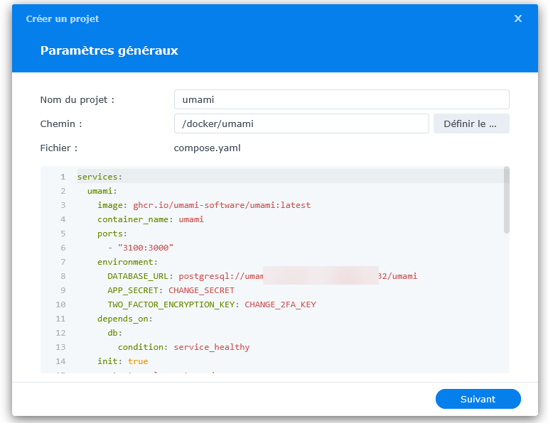
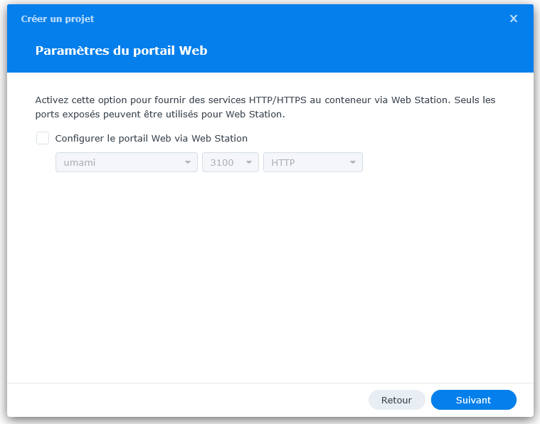
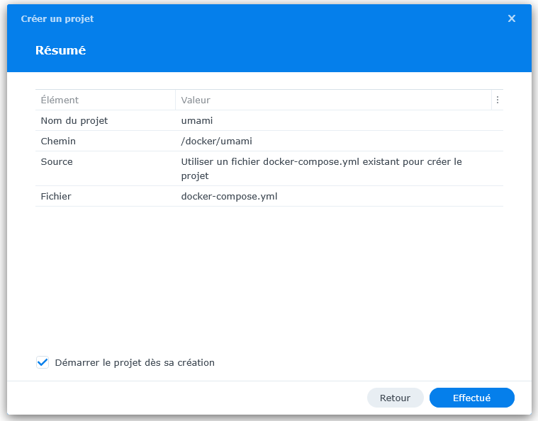
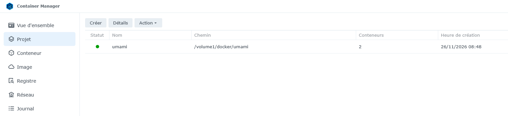
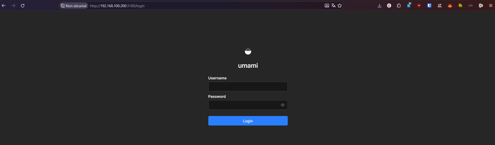
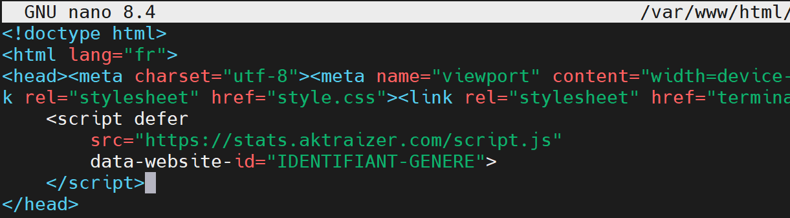
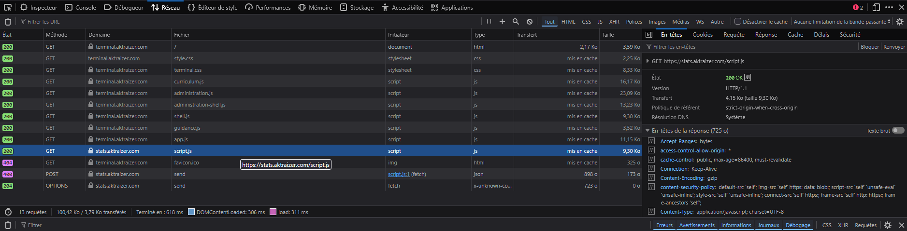
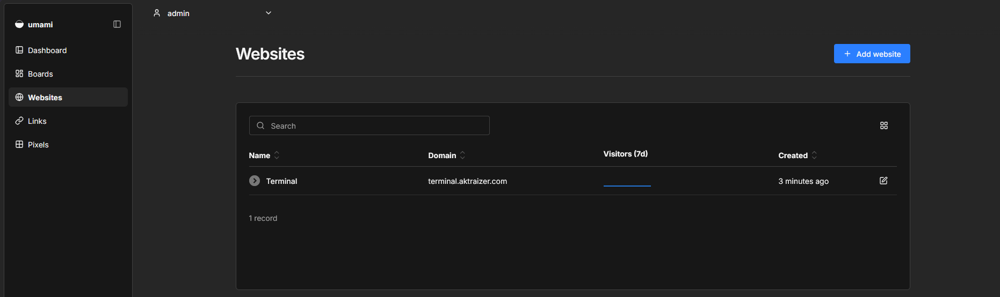
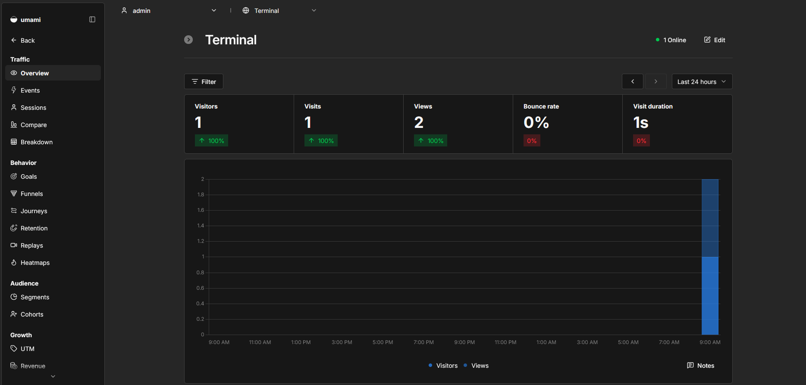

A la recherche d'une solution de statistiques pour votre site web, vous pouvez opter pour **Umami**. C'est une alternative open-source à Google Analytics, respectueuse de la vie privée des utilisateurs.

Dans mon HomeLab, j'ai mis en place Unami pour suivre les visites sur mon site web. Voici comment l'installer et le configurer.
Je vais l'installer sur un NAS Synology, mais vous pouvez l'installer sur n'importe quel serveur capable de faire tourner Docker.

Création des répertoires pour Unami et sa base de données PostgreSQL depuis File Station ou via SSH avec la commande suivante :

```bash
mkdir -p /volume1/docker/umami
mkdir -p /volume1/docker/umami/db
```

Créer un fichier docker-compose.yml dans le répertoire `/volume1/docker/umami` avec le contenu suivant :

```yaml
services:
  umami:
    image: ghcr.io/umami-software/umami:latest
    container_name: umami
    ports:
      - "3100:3000"
    environment:
      DATABASE_URL: postgresql://umami:CHANGE_MDP@db:5432/umami
      APP_SECRET: CHANGE_SECRET
      TWO_FACTOR_ENCRYPTION_KEY: CHANGE_2FA_KEY
    depends_on:
      db:
        condition: service_healthy
    init: true
    restart: unless-stopped

  db:
    image: postgres:15-alpine
    container_name: umami-db
    environment:
      POSTGRES_DB: umami
      POSTGRES_USER: umami
      POSTGRES_PASSWORD: CHANGE_MDP
    volumes:
      - /volume1/docker/umami/db:/var/lib/postgresql/data
    restart: unless-stopped
    healthcheck:
      test: ["CMD-SHELL", "pg_isready -U umami -d umami"]
      interval: 5s
      timeout: 5s
      retries: 5
```

Remplace CHANGE_MDP aux deux endroits par un mot de passe robuste.

Dans l'application **Container Manager** > **Projet** > **Créer** > **Créer**. 


- Donnez-lui un nom, par exemple `umami`.
- Un chemin : `/docker/umami`.
- Un fichier `docker-compose.yml`.



Ne pas forcement configurer le portail veb via Web Station, car Umami est accessible via le port 3100. Vous pouvez configurer un reverse proxy si vous le souhaitez.



- Choisir ensuite de démarrer le projet après la création.



Une fois le conteneur démarré, vous pouvez accéder à l'interface web d'Umami via l'adresse suivante : `http://<IP_DU_NAS>:3100`.





Pour simplifier l'accès, vous pouvez configurer un reverse proxy sur votre NAS Synology pour accéder à Umami via un nom de domaine ou un sous-domaine. Cela permet d'éviter d'utiliser le port 3100 dans l'URL.

Les identifiants par défaut pour se connecter à l'interface web d'Umami sont :
- Email : `admin`
- Mot de passe : `umami`

Pour le suivi des statistiques, vous devrez ajouter votre site web dans l'interface d'Umami et intégrer le script de suivi dans vos pages web.

```html
<script defer
    src="https://stats.aktraizer.com/script.js"
    data-website-id="IDENTIFIANT-GENERE">
</script>
```

:::caution
Bien remplacé l'identifiant généré par Umami dans le script ci-dessus. Il est unique pour chaque site web que vous ajoutez à Umami.
:::



On peut vérifier que le script fonctionne dans le navigateur en ouvrant la console (F12) et en vérifiant qu'il n'y a pas d'erreurs liées au script de suivi.

- Appuie sur F12.
- Sélectionne l'onglet Réseau (Network).
- Recharge la page.
- Vérifie que script.js et la requête /api/send retournent un code HTTP 200.



Dans Websites, nous pouvons ajouter un site web en cliquant sur le bouton "Add website". Il faudra renseigner le nom du site et l'URL.



Les stats commencent à remonter dès que le script est intégré et que les visiteurs accèdent à votre site web. Vous pourrez voir les pages vues, les visiteurs uniques, la durée des sessions, et d'autres métriques importantes pour analyser le trafic de votre site.


